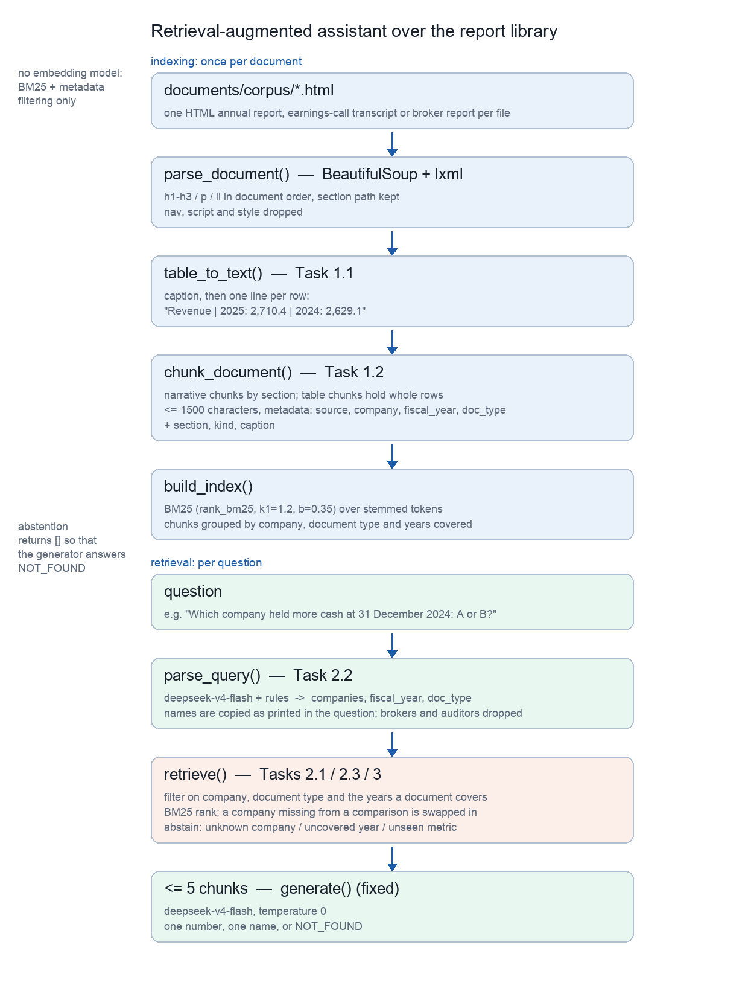

# FTEC5660 Homework 4 — the retrieval half of a RAG assistant over company reports

Individual homework, due 1 December 2025, 23:59 HKT.

The generator (`generate()` and its prompt) is fixed and given; everything that decides **what the
generator sees** is in `hw4.py`: `table_to_text`, `chunk_document`, `parse_query`, `build_index` and
`retrieve`. There is no embedding model anywhere: retrieval is BM25 plus metadata filtering.

```
python3 -m venv .venv && source .venv/bin/activate
pip install -r requirements.txt
echo "DEEPSEEK_API_KEY=your_key_here" > .env
python3 hw4.py --data-folder public_test            # the runner, writes results.csv
```

| file | what it is |
| --- | --- |
| `hw4.py` | the five functions and their helpers, above the provided code |
| `ablate.py` | Task 5: runs the eight configurations of the ablation study (`ablation_results.csv`) |
| `eval.py` | fast local scorer for Tasks 1.1–3 (`--generate` adds Task 4), plus per-question diagnostics |
| `diag.py` | prints, for every question, what was parsed, what was retrieved and why it abstained |
| `make_figure.py` | draws `docs/pipeline.png` |
| `results.csv` | the runner's output on `public_test` |
| `REFLECTION.md` | Task 6: the reflection, as a standalone file |

`requirements.txt` pins `langchain-core` to the 0.3 line: the provided code imports `Document`
from `langchain_core.documents`, which the 1.x line no longer exports, so an unpinned install
breaks the starter itself. The pins are the versions every number below was measured with.

---

## What the homework asked for

| Task | What it grades | Points |
| --- | --- | --- |
| 1.1 | `table_to_text`: every value on one line with its row label and column header, caption kept | 8 |
| 1.2 | `chunk_document`: chunks ≤ 1500 characters with `source`, `company`, `fiscal_year`, `doc_type` | 7 |
| 2.1 | `retrieve` returns 1–5 valid chunks for answerable questions | 5 |
| 2.2 | `parse_query`: companies, fiscal year, document type | 10 |
| 2.3 | recall@5 against the (document, printed fact) evidence | 15 |
| 3 | abstention: `[]` for unanswerable questions, chunks otherwise | 10 |
| 4 | end-to-end answer accuracy of the fixed generator | 20 |
| 5 | ablation study and this report | 15 |
| 6 | reflection | 10 |

---

## Homework 4 solution



### The pipeline in one paragraph

**Parsing.** Each document is read with BeautifulSoup (`lxml`). I walk the body in document order and
keep the current `<h2>`/`<h3>` as a section path, collecting two kinds of block: narrative blocks
(`p`, `li`) and tables. Every table goes through `table_to_text`, which expands `colspan`/`rowspan`
into a rectangular grid, prints the caption (it holds the unit), prints the header row, and then
writes **one line per table row** as `row label | header: value | header: value`, e.g.
`Revenue | 2025: 2,710.4 | 2024: 2,629.1`; cell text is never edited, so `2,710.4` and `(1,762.4)`
stay exactly as printed. **Chunking and metadata.** `chunk_document` builds chunks per section:
consecutive paragraphs are packed into ≈950-character chunks, and every table is cut into groups of
whole rows of ≈700 characters in which the caption and the header row are repeated, so that a chunk
stands on its own (a row without its caption loses the unit, a column without its header loses the
year). Each chunk starts with a one-line header `company | document type and fiscal year | section`
and carries the metadata `source`, `company`, `fiscal_year`, `doc_type` plus `section`, `kind` and
`caption`. The unit of retrieval is therefore a *row group*, not a page, because every graded fact is
a single number or name printed on one row of one table. **Index.** `build_index` fits BM25
(`rank_bm25`, `k1=1.2`, `b=0.35`) over tokens that are lower-cased and lightly stemmed (plurals,
`-ing`, `-ed`, silent final *e*), with fiscal years kept both as `fy2025` and `2025`, and it groups
the chunk ids by company. **Query understanding.** `parse_query` asks `deepseek-v4-flash` (JSON,
few-shot, temperature 0) for the companies a question asks about, keeps only names that are literally
printed in the question (so a hallucinated name cannot enter), drops brokers and audit firms by their
suffix and by the names collected from the corpus, and copies the name **exactly as printed**; the
fiscal year and the document type come from regular expressions (`FY2024`, `31 December 2024`,
`Q4`, `results review`, `target price`, …). A rule-based extractor produces the same three fields when
the call fails, so the pipeline degrades gracefully. **Retrieval.** `retrieve` filters the candidates
on company, document type and the years a document *actually covers* (an FY2025 annual report covers
2025 and 2024; a research report covers FY2024A–FY2027E), ranks the survivors with BM25, gives a
1.15 boost to the report of the year the question names, and for a comparison question it checks that
every company the question names is represented: if one is missing from the top five, the weakest
chunk of the best-represented company is swapped for that company's best chunk, so five chunks of one
company cannot reach the generator. **Abstention.** `retrieve` returns `[]` in three cases: the question names a company that
is not in the library; no document of the asked type covers the asked year (FY2021, FY2022); or the
fact asked for is never mentioned anywhere in the corpus, which is detected by looking the content
words of the question up in the index's document frequencies — a word the corpus never uses
(*lobbying*, *churn*, *carbon*, *single* as in "its largest single customer") marks the question
unanswerable, so the generator answers `NOT_FOUND` without being called.

### Results on the public set

`python3 hw4.py --data-folder public_test` (40 documents → 948 chunks, about a minute, 60 model calls
for parsing and 46 for generation):

| Task | 1.1 | 1.2 | 2.1 | 2.2 | 2.3 | 3 | 4 | total |
| --- | --- | --- | --- | --- | --- | --- | --- | --- |
| public score | 8.00 | 7.00 | 5.00 | 10.00 | 15.00 | 10.00 | 20.00 | **75.00 / 75** |
| measured | 100% of cells | 100% of docs | 100% | 100% of fields | recall@5 100% | kept 100% / rejected 100% | accuracy 100% | |

Accuracy is 100% in every category (table 22/22, comparison 12/12, fact 12/12, unanswerable 14/14).
Two robustness notes: `parse_query` falls back to plain rules when the model call fails, and with the
model switched off the rule fallback alone also gets 100% of the parse fields and 100% recall@5 on the
public set; nothing in `table_to_text` or `chunk_document` calls a model, and no index is committed.

### Ablation study

`python3 ablate.py --data-folder public_test` runs the eight configurations of below, changing **one
component at a time** relative to the row above it, and writes `ablation_results.csv`. Every variant
is the same `hw4.py` with one `CONFIG` flag flipped, so the table is exactly what the code does.

| # | configuration (one change per row) | chunks | recall@5 | MRR | both companies | Task 3 | accuracy | total |
| --- | --- | --- | --- | --- | --- | --- | --- | --- |
| B0 | naive RAG: `get_text()` of the document (no `table_to_text`), `RecursiveCharacterTextSplitter(chunk_size=1200, overlap=100)`, the required metadata, BM25 top-5 over the whole corpus with lower-cased whitespace tokens, no query parsing, never `[]` | 287 | 30.4% | 0.252 | 91.7% | 0.00 | 45.0% | 39.00 |
| V1 | + `table_to_text`: every table becomes one line per row inside the same flat text | 318 | 30.4% | 0.238 | 75.0% | 0.00 | 45.0% | 39.00 |
| V2 | + structural chunks: section-aware narrative chunks and table chunks of whole rows | 948 | 26.1% | 0.172 | 100% | 0.00 | 43.3% | 38.67 |
| V3 | + contextual chunk header `company \| document \| section` in the chunk text | 948 | 78.3% | 0.649 | 100% | 0.00 | 83.3% | 57.27 |
| V4 | + metadata filtering from `parse_query` (company, document type, year covered) | 948 | 97.8% | 0.775 | 100% | 3.57 | 100% | 68.57 |
| V5 | + rich BM25 tokens (stems, plurals, fiscal years, synonyms) | 948 | 100% | 0.891 | 100% | 3.57 | 100% | 68.57 |
| V6 | + per-company retrieval for comparison questions | 948 | 100% | 0.891 | 100% | 3.57 | 100% | 68.57 |
| V7 | + abstention: unknown company, uncovered year, unseen metric | 948 | 100% | 0.891 | 100% | 10.00 | 100% | **75.00** |

Tasks 1.1 and 1.2 contribute 8.00 and 7.00 to every row, because they grade `table_to_text` and
`chunk_document` directly: they can already be perfect while the pipeline that *uses* them is naive
(see B0), which is why the handout grades them on their own. `total` is the sum of the seven
automatic tasks as the runner computes them.

*Reading the table.* `recall@5` is Task 2.3 (full points from 90%), `Task 3` is the abstention
score, `accuracy` is Task 4, `MRR` is the mean reciprocal rank of the first retrieved chunk that
states a fact the question needs, and `both companies` is the share of comparison questions whose
five chunks come from both companies.

**The steps that did nothing on their own, but were needed later.** V1 and V2 cost nothing and gain
nothing: printing the table as `Revenue | 2025: 2,710.4 | 2024: 2,629.1` keeps the numbers and their
labels, but in the naive pipeline those lines sit in a 1,200-character chunk among ten other rows, and
the retriever still cannot tell the FY2024 chunk of one company from the FY2025 chunk of another. V1
even costs a little (MRR 0.252 → 0.238, "both companies" 91.7% → 75%) because the table text is longer,
so five chunks cover fewer documents. V2 makes the row group the unit of retrieval, which is a
precondition for everything after it, yet on its own it makes retrieval *worse* (recall 26.1%, MRR
0.172): 948 small chunks now compete, 110 of them carry a revenue row and 247 mention revenue, and with no
metadata the five best still come from the wrong document. This is the first honest surprise of the
study: cleaning the data does not help until the retriever is allowed to use the metadata that
cleaning produced.

**The two changes that mattered.** V3, the contextual header, is the largest single jump (recall
26.1% → 78.3%, accuracy 43.3% → 83.3%, Task 2.3 from 0 to 10.6 of 15): the company and the document
year are now words in every chunk, so BM25 can separate Kestrel from Halcyon without a filter, the
section path (`6. Financial statements / Consolidated income statement`) matches the vocabulary of the
question, and the generator is told which document it is reading. Table questions go from 18.2% to 68.2% correct
and comparisons from 0% to 83.3%. V4, metadata filtering, is the largest jump in precision (recall
78.3% → 97.8%, accuracy → 100%): with `parse_query` the candidate set drops from 948 chunks to a
handful — the right company, the right document type, the right two columns — and five slots become
plenty. It also earns 3.57 of Task 3 for free, because five of the fourteen unanswerable questions ask
about a year that no document of that type covers, so the candidate set is empty before the abstention
rule is even consulted.

**The last two recall points.** V5 (stems, plurals, fiscal years, synonyms) takes recall from 97.8% to
100% and MRR from 0.775 to 0.891. The missing question was q004, "Which company had the higher net
income in FY2024: Kestrel Semiconductor or Halcyon Freight?": with whitespace tokens the top five were
governance and risk chunks that say "net income" in prose, while the income-statement rows — the only
place where the two numbers sit side by side — never made it; with stems and year tokens they rank
first. MRR captures the rest of what recall@5 hides: on average the first chunk that actually states a
fact moves from rank 1.29 to 1.12, which matters because only five chunks reach the generator. V6
(per-company retrieval) changes nothing at this point — after V5 both companies of a comparison
already appear in the top five, so the swap never fires — and I keep it as a guard rather than for its
public score: with four documents per company and five slots, a question whose wording favours one
side can crowd the other out, and the rule is a strict no-op when that does not happen (MRR is
unchanged at 0.891, whereas a round-robin "two chunks per company" version cost 0.011 MRR for nothing,
so I replaced it with the swap).

**Abstention.** V7 adds 6.43 points of Task 3 and touches nothing else: kept stays 100%, rejected goes
from 35.7% (only the year rule) to 100%. Overall the public total moves from 39.00 to 75.00, and 36 of
those points are decisions about *what the generator sees*, not about the model.

### Error analysis

**What the naive baseline gets wrong.** B0 is 45% accurate, and the failures are not spread evenly:
table questions 13.6% (3/22) and comparisons 16.7% (2/12), against fact questions 66.7% and
unanswerable 100%. The dominant failure signature is not a wrong number but `NOT_FOUND`: the flat
chunks that share the question's words are usually about the wrong company — q020 asks for Brightwater
Energy's Midstream revenue and the five chunks are a broker report on Sablewood Retail, a borrowings
note of another company and a cash-flow page — and the generator refuses, correctly, instead of
answering. The failures that *are* wrong numbers are the interesting ones: a balance sheet chunk from
the FY2025 report answers a FY2023 question with the 2025 column, or a comparison returns the first
company because all five chunks belong to it. Both are the failure modes the handout warns about
("two years per table", "similar names"), and both are fixed by metadata (V4) rather than by a better
model.

**The generator is not a safety net.** At B0 the unanswerable questions are 14/14 correct even though
the retriever never returns `[]` — the chunks are about the wrong company, so the model says
`NOT_FOUND` by itself. That result is luck, and it disappears when retrieval improves: at V2 it is
92.9%. Even at V4–V6, where chunks are about the right company and the right year but for a figure the
report does not disclose ("lobbying expenses", "carbon offset purchases", "customer churn rate"), the
generator usually refuses — but "usually" is exactly the problem, and Task 3 grades the retriever, not
the generator's mood. This is why abstention is a separate component and not a prompt instruction.

**What is left at 75/75, and the real risk on the private set.** On the public set the final pipeline
makes no errors, so the remaining risk is everything that is tuned to the public wording. Three cases
worry me, in this order. (1) The "unseen metric" rule is lexical: it rejects a question when a content
word of the question never occurs in the corpus. That catches *lobbying*, *churn*, *carbon* and
"largest **single** customer", and the synonym table keeps legitimate paraphrases (*headcount* →
*employees*, *city* → *headquarters*, *forecast* → *estimate*) from being rejected; but an undisclosed
metric built from words that do occur elsewhere ("dividend per share" when only "dividends paid" is in
the report) would slip through and be answered with a plausible wrong number. I implemented a
model-based answerability check (`CONFIG["llm_check"]`) for exactly this case, and left it off: it
costs one model call per question and can reject an answerable one, and the lexical rule already
reaches 14/14 on the public set. (2) The year windows in `_doc_covers_year` are hard-coded per document
type (annual report: 20Y and 20Y−1; earnings call: 20Y and 20Y+1; research report: 20Y−1 … 20Y+2);
they are right for this data, but a private document with a different coverage would be filtered
wrongly. (3) `parse_query` depends on the model for company names. That part is safe: names are only
accepted if they appear verbatim in the question, and with the model switched off the rule fallback
alone gets 100% of the fields and 100% recall@5 on the public set, so an API failure costs a little
accuracy rather than the run. The next thing I would add is a cheap consistency check between the
question and the best chunk — does the row label of the chunk contain the item the question asks for? —
and a confidence threshold from the BM25 score distribution, which is the remaining signal I am not
using.

---

## Reflection (Task 6)

The reflection is in [REFLECTION.md](REFLECTION.md): the seven questions of Task 6, answered in
order.
